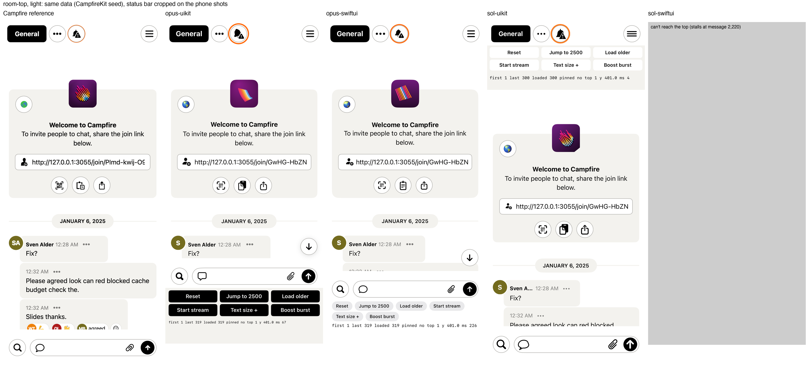
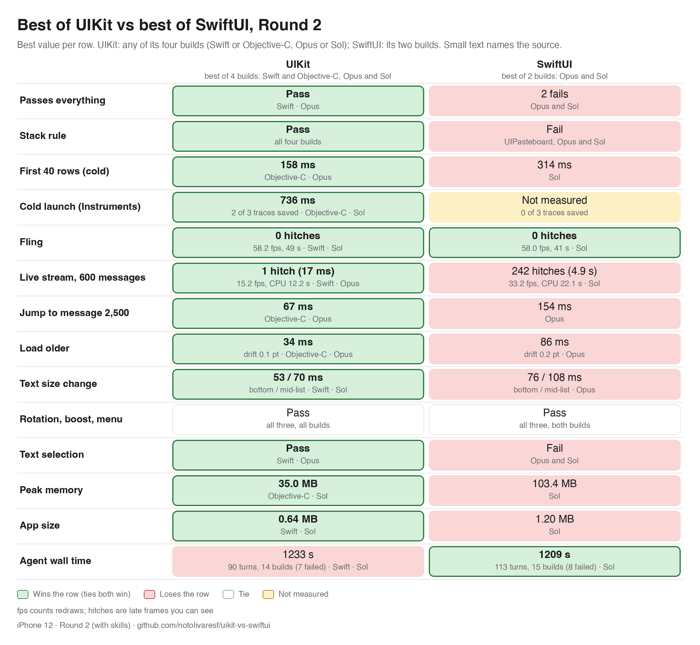
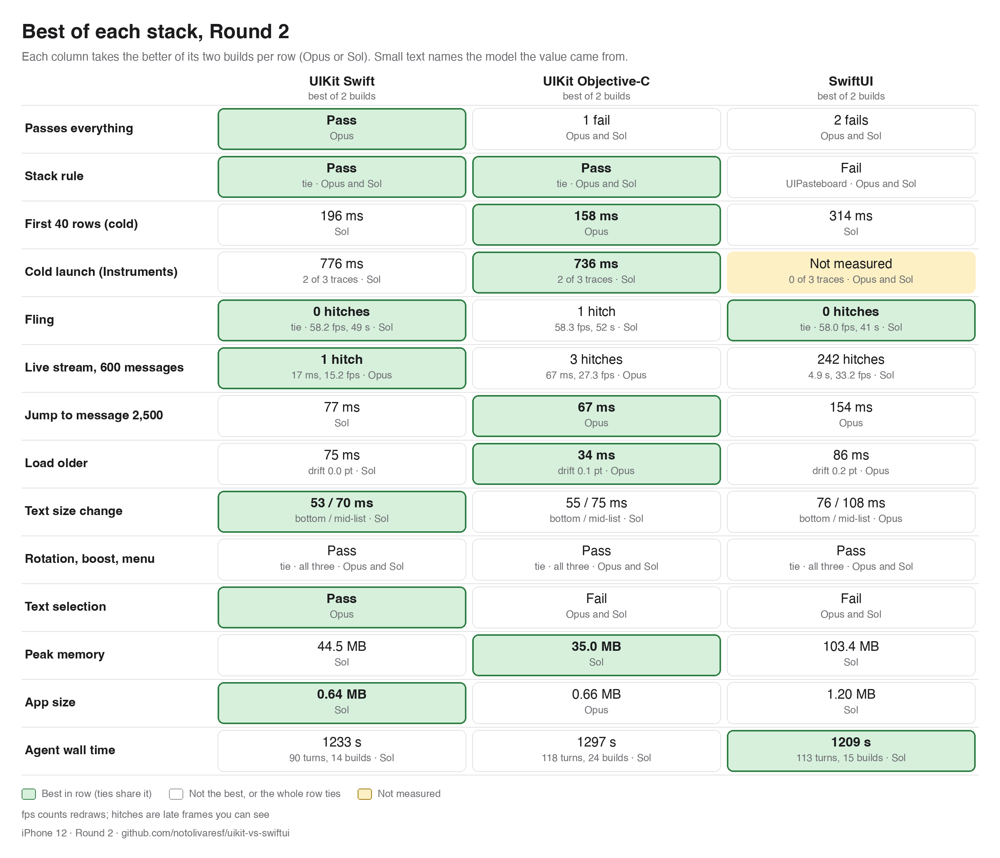
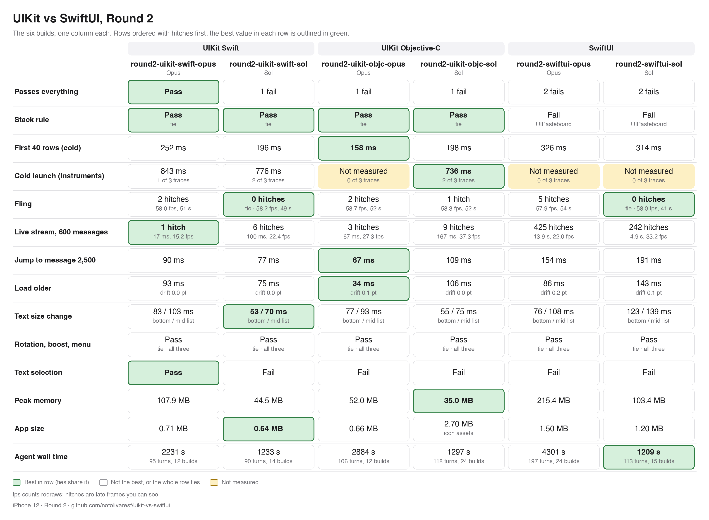
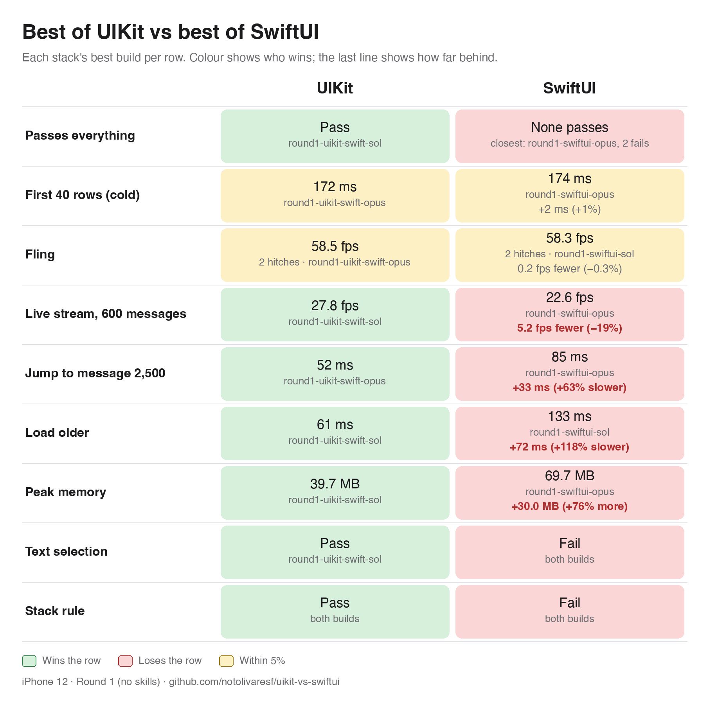
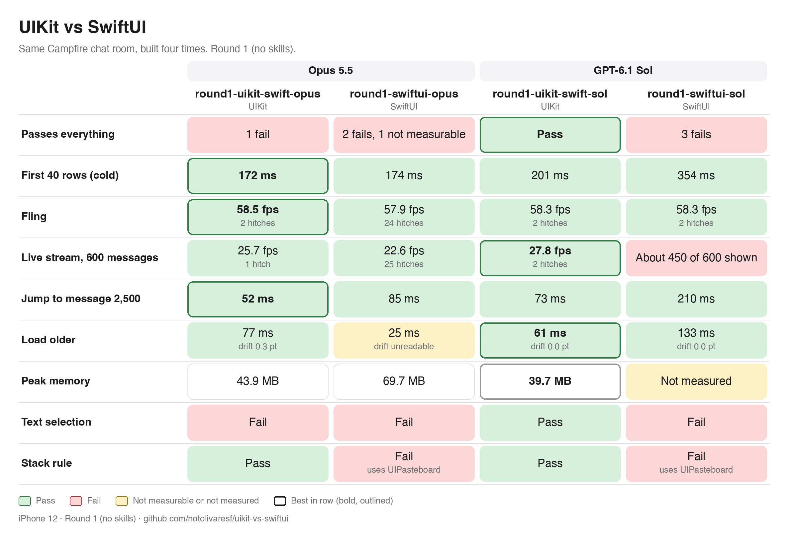

# The Experiment
Build a <a href="https://github.com/basecamp/once-campfire">Campfire chat room</a> in UIKit and in SwiftUI using Opus and Sol.

## Round 2: One prompt with skills.

The same Campfire chat room, built six times with a skill installed: Apple's Xcode 27 skills for SwiftUI (swiftui-specialist, swiftui-whats-new-27) and [my own UIKit skills](https://github.com/notolivaresf/uikit-skill) for Swift and for Objective-C, each by Opus and by Sol. The source of all six builds is in [`builds/`](builds) (Apple's skill text is not included).

<picture>
  <source media="(prefers-color-scheme: dark)" srcset="docs/images/results-round2-best-dark.png">
  
</picture>

<picture>
  <source media="(prefers-color-scheme: dark)" srcset="docs/images/results-round2-best3-dark.png">
  
</picture>

<picture>
  <source media="(prefers-color-scheme: dark)" srcset="docs/images/results-round2-dark.png">
  
</picture>

## Round 1: no skills

One Campfire chat room, built four times with no skills available for SwiftUI or UIKit, each by Opus and by Sol. The source of all four builds is in [`builds/`](builds).

<picture>
  <source media="(prefers-color-scheme: dark)" srcset="docs/images/results-round1-best-dark.png">
  
</picture>

<picture>
  <source media="(prefers-color-scheme: dark)" srcset="docs/images/results-round1-dark.png">
  
</picture>

## How it works

- **One prompt.** [`PROMPT.md`](PROMPT.md) asks for a single iPhone chat room copied 1:1 from the screenshots in [`screenshots/`](screenshots), light and dark, within 2 pt of [`Fixtures/constants.json`](Fixtures/constants.json).
- **One shared package.** [`CampfireKit`](CampfireKit) makes 50 people and 50,000 messages from a fixed seed, pages of 40, the threading rule and a live stream of 20 messages a second. Foundation only, so it is neutral.
- **Frozen inputs.** Prompt, package, fixtures and screenshots do not change once runs start.
- **Clean runs.** Each build starts in an empty folder with no memory of the others.

## The plan

- **Benchmarks** ([`Harness/`](Harness), [`docs/harness.md`](docs/harness.md)): cold launch, fling scroll, jump to message 2,500, load older, live stream. Frames per second (fps) and hitches for scrolling and the stream, plus CPU and memory; wall time for launch, jump and load older. Three alternating passes, headline = median.
- **Build time** ([`docs/timing.md`](docs/timing.md)), recorded in three stages: stage 1 messages show, stage 2 passes the behaviour tests including layout within 2 pt, stage 3 performance work. Also turns and failed builds.
- **Fairness:** same prompt, same budget, both models at high reasoning effort, results only for builds that pass.

Models: Opus 5.5 and GPT-6.1 Sol, each in UIKit and SwiftUI. Branches: `build/opus-uikit`, `build/opus-swiftui`, `build/sol-uikit`, `build/sol-swiftui`. Per-build results land in [`runs/`](runs).

## Credit

Campfire's design is ©️ 37signals, MIT: [basecamp/once-campfire](https://github.com/basecamp/once-campfire). No Campfire code is copied here.

MIT licensed, see [LICENSE](LICENSE).
