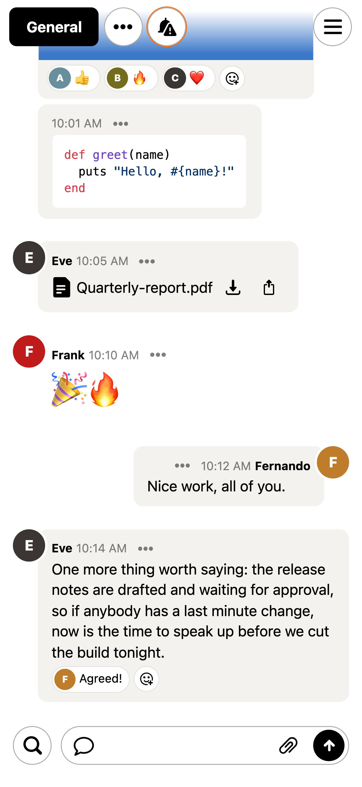
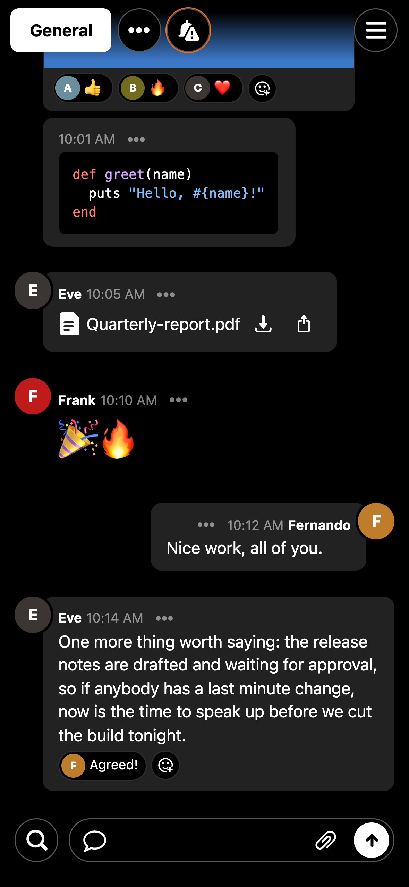

<h1 align="center">UIKit vs SwiftUI</h1>

One Campfire chat room, built twice, in UIKit and in SwiftUI, by AI models. 
Started after 37signals moved <a href="https://once.com">ONCE</a> off Rails.

<table align="center"><tr>
<td></td>
<td></td>
</tr></table>

## How it works

- **One prompt.** [`PROMPT.md`](PROMPT.md) asks for a single iPhone chat room copied 1:1 from the screenshots in [`screenshots/`](screenshots), light and dark, within 2 pt of [`Fixtures/constants.json`](Fixtures/constants.json).
- **One shared package.** [`CampfireKit`](CampfireKit) makes 50 people and 50,000 messages from a fixed seed, pages of 40, the threading rule and a live stream of 20 messages a second. Foundation only, so it is neutral.
- **Frozen inputs.** Prompt, package, fixtures and screenshots do not change once runs start.
- **Clean runs.** Each build starts in an empty folder with no memory of the others.

## The plan

- **Benchmarks** ([`Harness/`](Harness), [`docs/harness.md`](docs/harness.md)): cold launch, fling scroll, jump to message 2,500, load older, live stream. Clock, CPU, memory and hitches.
- **Tokens** ([`docs/tokens.md`](docs/tokens.md)), recorded at three levels: L1 messages show, L2 passes the behaviour tests including layout within 2 pt, L3 performance work.
- **Fairness:** same prompt, same budget, results only for builds that pass.

Models: Opus 5.5 and GPT-6.1 Sol, each in UIKit and SwiftUI. Branches: `build/opus-uikit`, `build/opus-swiftui`, `build/sol-uikit`, `build/sol-swiftui`. Per-build results land in [`runs/`](runs).

## Results

Results table: coming

## Credit

Campfire's design is (c) 37signals, MIT: [basecamp/once-campfire](https://github.com/basecamp/once-campfire). No Campfire code is copied here.

MIT licensed, see [LICENSE](LICENSE).
