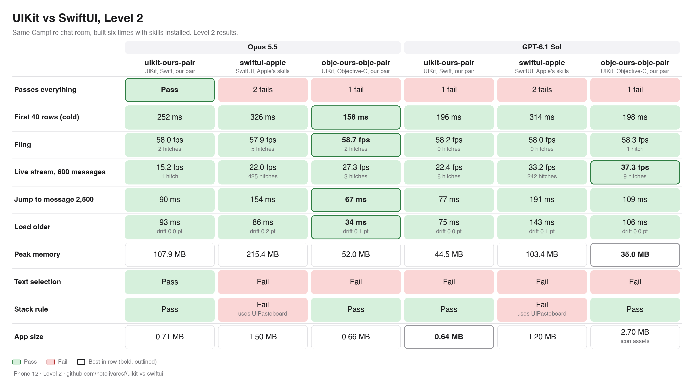
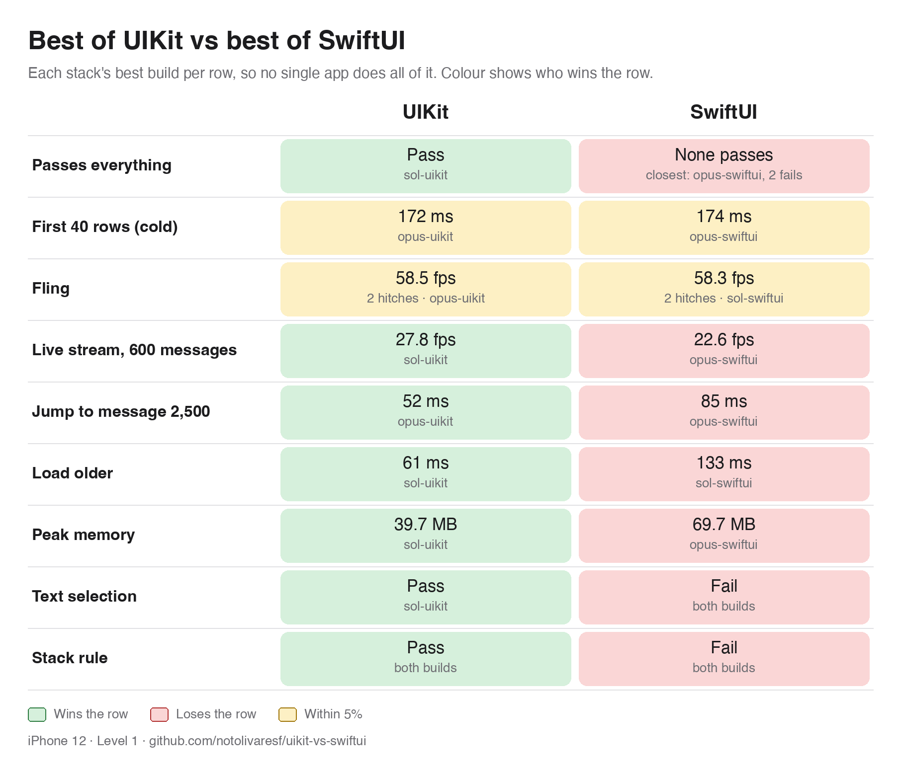
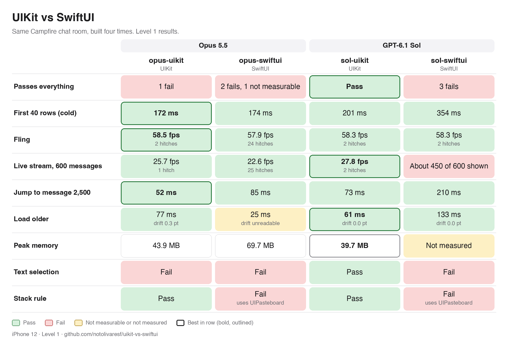

One Campfire chat room, built twice, in UIKit and in SwiftUI, by AI models. 
Started after 37signals moved <a href="https://once.com">ONCE</a> off Rails.

## Level 2: with skills

The same Campfire chat room, built six times with a skill installed: Apple's Xcode 27 skills for SwiftUI, and [our UIKit skills](https://github.com/notolivaresf/uikit-skill) for Swift and for Objective-C, each by Opus and by Sol. Best of UIKit against best of SwiftUI, row by row:

The source of all six builds is in [`builds/`](builds) (Apple's skill text is not included).

<picture>
  <source media="(prefers-color-scheme: dark)" srcset="docs/images/results-l2-best-dark.png">
  
</picture>

Three columns, each stack's better build per row (the small text names Opus or Sol):

<picture>
  <source media="(prefers-color-scheme: dark)" srcset="docs/images/results-l2-best3-dark.png">
  
</picture>

Details: [`docs/results-l2-best.md`](docs/results-l2-best.md) (the picks and takeaways) and [`docs/results-l2.md`](docs/results-l2.md) (all six builds). All six builds, grouped by stack:

<picture>
  <source media="(prefers-color-scheme: dark)" srcset="docs/images/results-l2-dark.png">
  
</picture>

## Level 1: no skills

<picture>
  <source media="(prefers-color-scheme: dark)" srcset="docs/images/results-best-dark.png">
  
</picture>

<picture>
  <source media="(prefers-color-scheme: dark)" srcset="docs/images/results-dark.png">
  
</picture>

Full numbers and notes: [`docs/results-l1.md`](docs/results-l1.md). The builds are in [`builds/`](builds). These results describe this app and these models, not UIKit vs SwiftUI in general. One round per build, so there is no spread between rounds.

*Every column shows the same Campfire data; sol-swiftui can't reach the top, because it keeps 300 messages loaded and Load older stops at message 2,220.*

Table as text

| | UIKit (best build) | SwiftUI (best build) |
|---|---|---|
| **Passes everything** | Wins: Pass (sol-uikit) | Loses: None passes (closest: opus-swiftui, 2 fails) |
| **First 40 rows (cold)** | Within 5%: 172 ms (opus-uikit) | Within 5%: 174 ms (opus-swiftui), +2 ms (+1%) |
| **Fling** | Within 5%: 58.5 fps, 2 hitches (opus-uikit) | Within 5%: 58.3 fps, 2 hitches (sol-swiftui), 0.2 fps fewer (−0.3%) |
| **Live stream, 600 messages** | Wins: 27.8 fps (sol-uikit) | Loses: 22.6 fps (opus-swiftui), 5.2 fps fewer (−19%) |
| **Jump to message 2,500** | Wins: 52 ms (opus-uikit) | Loses: 85 ms (opus-swiftui), +33 ms (+63% slower) |
| **Load older** | Wins: 61 ms (sol-uikit) | Loses: 133 ms (sol-swiftui), +72 ms (+118% slower) |
| **Peak memory** | Wins: 39.7 MB (sol-uikit) | Loses: 69.7 MB (opus-swiftui), +30.0 MB (+76% more) |
| **Text selection** | Wins: Pass (sol-uikit) | Loses: Fail (both builds) |
| **Stack rule** | Wins: Pass (both builds) | Loses: Fail (both builds) |

<table align="center"><tr>
<td></td>
<td></td>
</tr></table>

## How it works

- **One prompt.** [`PROMPT.md`](PROMPT.md) asks for a single iPhone chat room copied 1:1 from the screenshots in [`screenshots/`](screenshots), light and dark, within 2 pt of [`Fixtures/constants.json`](Fixtures/constants.json).
- **One shared package.** [`CampfireKit`](CampfireKit) makes 50 people and 50,000 messages from a fixed seed, pages of 40, the threading rule and a live stream of 20 messages a second. Foundation only, so it is neutral.
- **Frozen inputs.** Prompt, package, fixtures and screenshots do not change once runs start.
- **Clean runs.** Each build starts in an empty folder with no memory of the others.

## The plan

- **Benchmarks** ([`Harness/`](Harness), [`docs/harness.md`](docs/harness.md)): cold launch, fling scroll, jump to message 2,500, load older, live stream. Frames per second (fps) and hitches for scrolling and the stream, plus CPU and memory; wall time for launch, jump and load older. Three alternating rounds, headline = median.
- **Build time** ([`docs/timing.md`](docs/timing.md)), recorded at three levels: L1 messages show, L2 passes the behaviour tests including layout within 2 pt, L3 performance work. Also turns and failed builds.
- **Fairness:** same prompt, same budget, both models at high reasoning effort, results only for builds that pass.

Models: Opus 5.5 and GPT-6.1 Sol, each in UIKit and SwiftUI. Branches: `build/opus-uikit`, `build/opus-swiftui`, `build/sol-uikit`, `build/sol-swiftui`. Per-build results land in [`runs/`](runs).

## Credit

Campfire's design is (c) 37signals, MIT: [basecamp/once-campfire](https://github.com/basecamp/once-campfire). No Campfire code is copied here.

MIT licensed, see [LICENSE](LICENSE).
