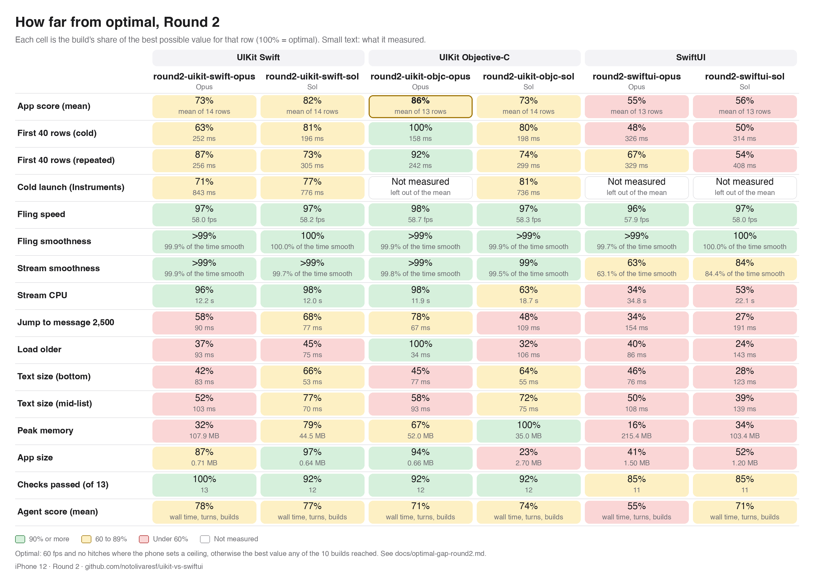

# How far from optimal, Round 2

> Fernando, 20 Oct: "Before we do it [Round 3], I actually want to know how far from optimal each one is."

This page answers that for the six Round 2 builds. It uses only numbers already published in [results-round2.md](results-round2.md) and [results-round1.md](results-round1.md), plus a read of each build's source. Nothing was rebuilt or re-measured.

(Dark version: `images/optimal-gap-round2-dark.png`. To render it: `python3 Harness/tools/results_table.py --round2-gap`. The numbers live in `GAP_ROWS` in that file.)

Terms used on this page:

- **fps**: frames per second.
- **Hitch**: a frame that arrives late enough to see.
- **CPU**: processor time.
- **ms / s**: milliseconds / seconds.
- **MB**: megabytes.
- **pt**: points, the iPhone's layout unit.
- **Opus** is Opus 5.5 and **Sol** is GPT-6.1 Sol.

## What "optimal" means here

There are two kinds of optimal:

1. **A hard ceiling** where the phone or the spec sets one. The iPhone 12 screen redraws 60 times a second, so fling speed is out of 60 fps. Smoothness is out of "no hitches". Behaviour is out of all 13 checks: the 12 numbers in PROMPT.md plus the stack rule.
2. **Best seen** where there is no ceiling: time, memory, CPU and size. That is the best value any of the ten builds reached (Round 1's four plus Round 2's six). The table names the build that set it. This is a floor we know is reachable on this phone, not a theoretical limit. A perfect app could beat it.

Score per row, as "% of optimal":

| Row type | Formula | Example |
|---|---|---|
| Lower is better (ms, s, MB) | optimal ÷ value | jump 90 ms against a best of 52 ms → 58% |
| Higher is better (fps) | value ÷ 60 | 58.0 fps → 97% |
| Smoothness | share of the trace without hitches: 1 − (hitch time ÷ trace length) | 13.9 s of hitches in a 37.6 s stream → 63% |
| Pass/fail | checks passed ÷ 13 | 12 of 13 → 92% |

**App score** is the plain mean of the 14 app rows below, with every row weighted the same. A row that was not measured is left out of that build's mean and never counted as zero. Cold launch is missing for three builds, so their mean covers 13 rows. Leaving cold launch out for everyone changes no build by more than 0.6 points (second table).

**Agent score** is a separate mean of three rows: wall time, turns, and the share of builds that compiled. It describes how the agent worked, not how good the app is, so it is kept apart from the app score.

### Rows left out, and why

- **Stream fps.** The stream adds about 20 messages a second. A build that redraws only when a message lands draws fewer frames and still looks smooth: round2-uikit-swift-opus shows 15.2 fps with 1 hitch. Stream fps has no meaningful 60 fps target, so the stream is scored on smoothness and CPU instead.
- **Drift** (how far the list moves when it should hold still). Every build stayed within 0.2 pt against the spec's 2 pt, so all six would score 100%.
- **Rotation, boost burst, context menu.** All six pass all three. They are part of the 13 checks.

## The table

| Row | Optimal (source) | swift-opus | swift-sol | objc-opus | objc-sol | swiftui-opus | swiftui-sol |
|---|---|---|---|---|---|---|---|
| **App score** | 100% | **73%** | **82%** | **86%** | **73%** | **55%** | **56%** |
| First 40 rows, cold | 158 ms (round2-uikit-objc-opus) | 63% (252 ms) | 81% (196) | 100% (158) | 80% (198) | 48% (326) | 50% (314) |
| First 40 rows, repeated | 222 ms (round1-uikit-swift-opus) | 87% (256) | 73% (305) | 92% (242) | 74% (299) | 67% (329) | 54% (408) |
| Cold launch (Instruments) | 596 ms (round1-uikit-swift-opus) | 71% (843) | 77% (776) | not measured | 81% (736) | not measured | not measured |
| Fling speed | 60 fps (screen) | 97% (58.0) | 97% (58.2) | 98% (58.7) | 97% (58.3) | 96% (57.9) | 97% (58.0) |
| Fling smoothness | no hitches | >99% | 100% | >99% | >99% | >99% | 100% |
| Stream smoothness | no hitches | >99% | >99% | >99% | 99% | **63%** (13.9 s of 37.6 s) | **84%** (4.9 s of 31.1 s) |
| Stream CPU | 11.7 s (round1-uikit-swift-sol) | 96% (12.2) | 98% (12.0) | 98% (11.9) | 63% (18.7) | 34% (34.8) | 53% (22.1) |
| Jump to message 2,500 | 52 ms (round1-uikit-swift-opus) | 58% (90) | 68% (77) | 78% (67) | 48% (109) | 34% (154) | 27% (191) |
| Load older | 34 ms (round2-uikit-objc-opus) | 37% (93) | 45% (75) | 100% (34) | 32% (106) | 40% (86) | 24% (143) |
| Text size, at the bottom | 35 ms (round1-swiftui-opus) | 42% (83) | 66% (53) | 45% (77) | 64% (55) | 46% (76) | 28% (123) |
| Text size, mid-list | 54 ms (round1-swiftui-opus) | 52% (103) | 77% (70) | 58% (93) | 72% (75) | 50% (108) | 39% (139) |
| Peak memory | 35.0 MB (round2-uikit-objc-sol) | 32% (107.9) | 79% (44.5) | 67% (52.0) | 100% (35.0) | 16% (215.4) | 34% (103.4) |
| App size | 0.62 MB (round1-uikit-swift-sol) | 87% (0.71) | 97% (0.64) | 94% (0.66) | 23% (2.70) | 41% (1.50) | 52% (1.20) |
| Checks passed | 13 of 13 | 100% (13) | 92% (12) | 92% (12) | 92% (12) | 85% (11) | 85% (11) |
| **Agent score** | 100% | 78% | 77% | 71% | 74% | 55% | 71% |
| Agent wall time | 1200 s (round1-uikit-swift-sol) | 54% (2231) | 97% (1233) | 42% (2884) | 93% (1297) | 28% (4301) | 99% (1209) |
| Agent turns | 75 (round1-uikit-swift-opus) | 79% (95) | 83% (90) | 71% (106) | 64% (118) | 38% (197) | 66% (113) |
| Builds that compiled | all of them | 100% (12 of 12) | 50% (7 of 14) | 100% (12 of 12) | 67% (16 of 24) | 100% (24 of 24) | 47% (7 of 15) |

Column names drop the `round2-` prefix and the `uikit-` part. For example, swift-opus is round2-uikit-swift-opus.

App score with cold launch left out for everyone (13 rows each):

| swift-opus | swift-sol | objc-opus | objc-sol | swiftui-opus | swiftui-sol |
|---|---|---|---|---|---|
| 73% | 82% | 86% | 73% | 55% | 56% |

Reading it:

- **round2-uikit-objc-opus is closest to optimal, at 86%.** It sets the best value on two rows (first content and load older) and is near the top on most others. Its gaps are text selection, text size, and jump.
- **round2-uikit-swift-sol is next, at 82%.** It has no row below 45% and is the most even build.
- **The two SwiftUI builds sit at 55-56%.** Their stream, memory, jump and text-size rows are all low.
- **The rows where every build is far from optimal** are load older (24-45% except objc-opus), text size (28-77%) and jump (27-78%). Each of these is a "change the list" moment. The code read shows each build doing much more work there than it needs to (below).
- **Smoothness is the row where the stacks split.** All four UIKit builds keep scrolling and the stream more than 99% free of hitches. The two SwiftUI builds stutter for 16-37% of the stream.

## What's left on the table, build by build

The savings below are estimates from reading the code, not measurements. Each one names the row it would move. File paths are relative to `builds/<build>/Campfire/`.

### round2-uikit-swift-opus (app 73%)

The only build that passes all 13 checks. What holds it back is memory and the "change the list" rows.

1. **Images are kept at full size in a cache with no limit** (`MessageCell.swift:238-261`). Each placeholder image is decoded at its source size, up to 1200 × 900, and held in a cache with no size cap. It is only shown about 300 pt wide. The Objective-C builds decode at display size and cap the cache. Peak memory: about −45 to −55 MB (107.9 → about 55-60 MB, 32% → about 60%).
2. **Every message text is measured twice** (`RowLayout.swift:238` and `:243`, then again at `:299` and `:307`). Each text is laid out once at an unlimited width to find its natural width, then again at the real width. Reusing the first result when it fits would save the second pass. Load older −25 to −40 ms, text size −15 to −25 ms, jump −10 to −15 ms.
3. **Every row view loads five icons when it is created** (`MessageCell.swift:19-25`, `Views.swift:117-121`). The file and boost icons are looked up for every row, even rows with no file or boost. Shared icons would save that. First 40 rows: −20 to −40 ms (a smaller bet).
4. **The code highlighter makes a small array for every character** (`CodeHighlighter.swift:55`). Text size and jump: −5 to −15 ms.
5. **Each stream batch rebuilds the whole list description and its layout** (`RoomViewController.swift:169-176`, `RoomLayout.swift:22-46`). Stream CPU: −0.3 to −0.5 s. Low value, since the stream already has only 1 hitch.

### round2-uikit-swift-sol (app 82%)

The most even build. Its only miss is text selection.

1. **Text selection: the custom text menu replaces the system one** (`MessageCell.swift:19-26`). The menu offers only Copy and Reply and drops the system's own items (Look Up, Translate, Select All). The test recognises selection by those items. Keeping them and adding Reply would fix it. Checks: 12 → 13.
2. **The whole layout is rebuilt on every change** (`RoomViewController.swift:75-82`, `:236-245`). Each message is its own section. Every stream batch (every 80 ms) and every page load throws the layout away and lays it out twice. Jump, load older and text size would each gain, probably 15-30 ms.
3. **Up to 300 rows are compared field by field on every change** (`RoomViewController.swift:207-227`), even when only one row changed. This feeds the same rows as item 2.
4. **Each row view throws away and rebuilds its boost pills, avatar and add-boost button every time it is reused** (`MessageCell.swift:172-197`). Fling and stream CPU would gain a little; the jump and first-content rows a few ms.
5. **The mention avatar is redrawn for every layout, and the code-colouring pattern is compiled on every call** (`MessageLayout.swift:106-118`, `:199`). Text size and load older: a few ms each.

### round2-uikit-objc-opus (app 86%, closest to optimal)

Best value of all ten builds for first content (158 ms) and load older (34 ms).

1. **Text selection: the same menu mistake as swift-sol** (`CFMessageCell.m:365-376`). Copy and Reply replace the system's items. The fix is to keep the suggested items and add Reply. The bubble's own long-press menu also needs to stand aside when the press lands on text, as swift-opus does (`builds/round2-uikit-swift-opus/Campfire/MessageCell.swift:215-218`). Checks: 12 → 13.
2. **Code colouring compiles five search patterns for every code row** (`CFRowLayout.m:127-139`) on every row build, text size change and page load. Making them shared would save that. Jump −5 to −10 ms, text size −5 to −15 ms.
3. **A jump builds 81 rows at once for about 10 on screen** (`CFRoomViewController.m:775-787`). Building the visible rows first would help. Jump: 67 → about 52 ms.
4. **Each stream message rebuilds every row's position and lays the list out twice** (`CFRoomViewController.m:351-385`, `:498-513`, `:711-735`). There is no batching, unlike the Swift builds. Stream: 3 hitches → about 1, CPU −0.2 to −0.4 s.
5. **The loaded rows and two caches only ever grow** (`CFRoomViewController.m:111-113`, `:600-610`, `CFRoomStore.m:32`, `:58-62`). The other builds trim to about 300 rows. Memory here: about −5 MB, more in a longer session.

### round2-uikit-objc-sol (app 73%)

Lowest memory of all ten (35.0 MB). Most of its score is lost on four rows: app size, load older, jump and stream CPU.

1. **App size is mostly the icon** (`Assets.xcassets/AppIcon.appiconset`, 2.1 MB of the 2.70 MB). A compressed icon brings the app to about 0.6 MB. App size: 23% → about 100%. That one row is worth about 5 points of app score.
2. **Every reuse of a row view tears down and recreates all its pieces** (`CFMessageView.m:155-238`, with `addText` at `:261-265` and avatars at `:31-40`). That means new text views, labels, buttons and pills, and avatars drawn again with no cache. This is the main reason it has the highest stream CPU of the UIKit builds (18.7 s) and slow jump. Stream CPU: about −5 s, jump −30 to −40 ms.
3. **Each stream message rebuilds the whole list and lays it out twice, with no batching** (`CFRoomController.m:263-276`, `applyWithAnchor` at `:165-181`). That explains why it draws the most stream frames (37.3 fps) and burns the CPU. Stream CPU: a further −1 to −2 s, hitches 9 → a few.
4. **Load older measures every loaded row again**, up to 300, not just the 40 new ones (`CFRoomController.m:156-161`, `:243`). Load older: 106 → about 45 ms.
5. **Text selection: the same menu mistake** (`CFMessageView.m:255-260`). Checks: 12 → 13.
6. Minor: a code-colouring pattern is compiled per code row (`CFMessageView.m:77`), mention avatars are drawn per measure (`:62`), and one lookup scans a list item by item (`CFRoomController.m:170`).

### round2-swiftui-opus (app 55%)

Most memory of all ten builds (215 MB) and the worst stream.

1. **The list is not lazy: every loaded row is built and laid out on every change** (`RoomView.swift:54-64`, a plain `VStack` in a `ScrollView`). Up to about 340 rows are live at once, each with its own views and accessibility entry, and each of the 600 stream messages lays all of them out again. The build tracks its scroll position from measured row positions, which is probably why it avoided a lazy list. A lazy list anchored by message id would fix both. Rough estimates (this is the biggest single item in the six builds):
   - stream hitches 425 → under 30 (smoothness 63% → about 97%)
   - CPU −20 s
   - memory 215 → about 80-100 MB
   - jump 154 → about 80 ms
2. **Every row reports its position, and each report can start a scroll correction** (`MessageRow.swift:38-40`, `RoomModel.swift:392-396`, `:440-493`). When the stream trims old rows (about once a second) or older rows are added, every remaining row moves. That means up to 300 reports, each able to re-run the correction, which can repeat up to 20 times. This overlaps with item 1 and is probably much of the stream stutter and the 154 ms jump.
3. **The custom bubble layout measures its contents several times per pass, with no cache** (`MessageRow.swift:141-158`; the boost pills do the same in `RowParts.swift:276-305`). Row layout −30 to −50%, which helps jump, load older and stream CPU (about −3 to −5 s).
4. **Code blocks are coloured again on every redraw, one character at a time** (`RowParts.swift:65`, `:96-150`). Text size and jump: −10 to −30 ms.
5. **Stack rule and selection** (`RowParts.swift:2`, `Selection.swift`). The app imports UIKit only for Copy, and it draws its own selection handles and menu instead of the system's, so the selection test never sees the system menu. Using the system's text selection would bring Copy for free, remove the UIKit import, and pass both checks. Checks: 11 → 13.

### round2-swiftui-sol (app 56%)

Same shape as swiftui-opus, with fewer hitches and half the memory.

1. **The list is not lazy** (`RoomView.swift:72-86`, a plain `VStack` in a `ScrollView`). Every loaded row, up to 300, is built and laid out. Memory about −50 MB, jump about −100 ms, load older also faster.
2. **Every row publishes its position on every layout pass, and any change triggers a scroll correction** (`RoomView.swift:77-82`, `:116-124`, `:161-182`). In the stream, each message moves every row (old rows are trimmed past 80, `RoomStore.swift:126-129`). So each message forces another full layout and another scroll. This is the main cause of the 242 hitches and 22 s of CPU. Removing it would bring stream smoothness from 84% to about 99% and CPU to about 13 s.
3. **No batching: each of the 20 messages a second re-runs the whole room view** (`RoomStore.swift:115-131`). Collecting them once per frame would help. This overlaps with item 2.
4. **The custom layouts measure text two or three times per pass, with no cache** (`MessageRow.swift:300-314`, `:319-326`; the metadata line at `:96` measures both of its versions). This is why text size takes 123/139 ms against a best of 35/54. Text size about −50 ms.
5. **Stack rule and selection** (`MessageRow.swift:3`, `:77-80`). A long-press menu on the bubble takes over the press, so the system's selection menu never shows, and the UIKit import exists only for the custom Copy. Letting the system handle selection would bring its own Copy and pass both checks. Checks: 11 → 13.
6. Minor: a date formatter is built for every row (`RoomStore.swift:20-26`), and code blocks are coloured again on every redraw (`MessageRow.swift:220-237`).

## The waste most builds share

- **Redoing the whole list for a change to one part of it.** All six builds do this in some form. The two SwiftUI builds lay out every loaded row because their lists are not lazy. The UIKit builds rebuild the full list description and layout on every stream batch or page load, re-measure every row, or recreate a row's pieces on every reuse. This is what keeps jump, load older and text size at 24-78% of the best seen, even in the UIKit builds.
- **Measuring the same text more than once.** This shows up in swift-opus (twice per text), objc-sol (all rows again on load older) and both SwiftUI builds (custom layouts with no cache).
- **Replacing the system text menu.** This fails text selection in five of six builds. The three UIKit misses drop the system's menu items for a custom Copy and Reply. The two SwiftUI builds block or redraw selection, and that same choice is what pulls in UIKit for Copy and fails the stack rule. Swift-opus, the only build that kept the system items, passes everything.
- **Compiling a search pattern, drawing an avatar, or building a formatter for every row.** These cost a few ms each in four builds.

## Limits

- One measured pass per build, so differences of a few ms are noise. See [results-round2.md](results-round2.md#known-limits).
- "Best seen" is not a hard floor. The text size optimal (35/54 ms) comes from round1-swiftui-opus, a build that fails other checks. It shows the phone can do it, nothing more.
- Fling speed is drawing time over frames, and even a perfect app may read a little under 60 fps that way. 97-98% is close to the ceiling.
- Cold launch is missing for three builds because Instruments did not save their traces. It is left out of their means, not scored as zero.
- The savings are estimates from reading the code. They overlap, so they do not add up. Only a rebuild and a new pass would confirm them.
- Code review of the three Opus builds was done by a Sonnet subagent, and a sample of its line references was checked against the source. The three Sol builds were read directly.
