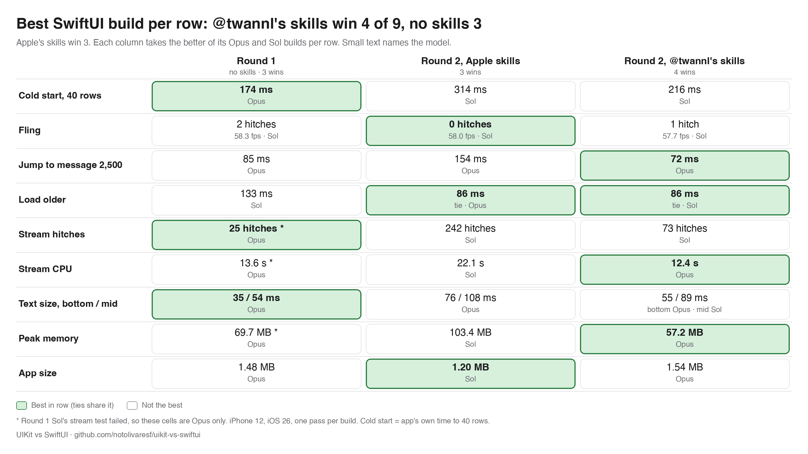
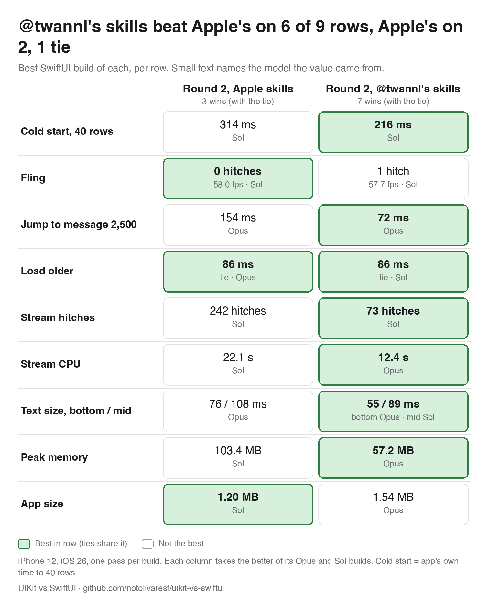
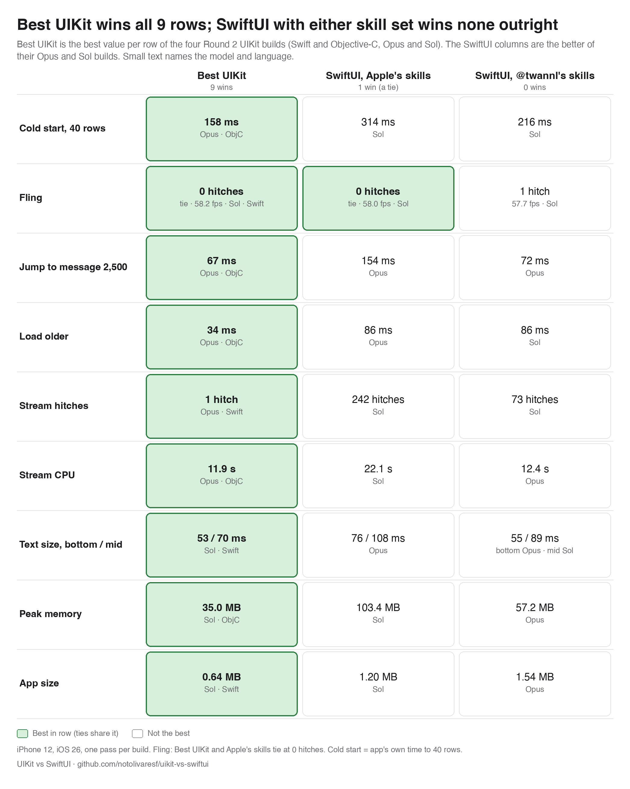

# Level 2, SwiftUI: Apple skills against third-party skills (AvdLee)

Fernando, 21 Oct: run the two Level 2 SwiftUI builds again, Opus and Sol, with only the skill of [AvdLee/SwiftUI-Agent-Skill](https://github.com/AvdLee/SwiftUI-Agent-Skill): "comparable to the experiment that we did with Apple's skills but these are third party skills". Everything is as in the Level 2 Apple-skill builds (same prompt, stack line, skill sentence, inputs, CampfireKit, fixtures, model, effort, flags, Codex config) except the skill set. The UIKit and Objective-C builds are not part of this.

| Arm | Skills installed | Builds |
|---|---|---|
| Apple skills | `swiftui-specialist`, `swiftui-whats-new-27` (Xcode 27.0 RC, not vendored) | `opus-swiftui-apple`, `sol-swiftui-apple` (Round 2, 19 Oct) |
| third-party skills (AvdLee) | `swiftui-expert-skill` 5.2.1, commit `204dba7`, MIT (vendored in `skills/avdlee/`) | `opus-swiftui-avdlee`, `sol-swiftui-avdlee` (21 Oct) |

Setup, hashes and the isolation probe: `docs/harness.md` ("Level 2, third-party skills: AvdLee") and `skills/README.md`. In short: the Opus init event listed `swiftui-expert-skill` and nothing else (no MCP servers), Sol's Codex config is the same file as Level 2's (24 host skills off) and Sol named only `swiftui-expert-skill`. Inputs are tag `v2-inputs`, as for the Apple arm; tag `v2-avdlee-inputs` marks the harness commit.

## Charts (iPhone 12)

The third-party skill set is by Antoine van der Lee (@twannl on X); the charts call it "@twannl's skills". Each SwiftUI column takes the better of its Opus and Sol builds per row. Made by `Harness/tools/results_table.py` (`--swiftui-3way`, `--swiftui-skills`, `--uikit-vs-swiftui-skills`).

**SwiftUI, three ways.** Round 1 (no skills), Round 2 with Apple's skills and Round 2 with @twannl's skills, best build per row: @twannl's skills win 4 of 9 rows, no skills 3, Apple's skills 3 (one row is a tie).

<picture>
  <source media="(prefers-color-scheme: dark)" srcset="images/results-swiftui-3way-dark.png">
  
</picture>

**Apple's skills against @twannl's skills.** @twannl's skills beat Apple's on 6 of 9 rows (cold start, jump, stream hitches, stream CPU, text size, peak memory), Apple's on 2 (fling, app size), and load older ties at 86 ms.

<picture>
  <source media="(prefers-color-scheme: dark)" srcset="images/results-swiftui-skills-dark.png">
  
</picture>

**UIKit against both SwiftUI skill sets.** The best UIKit build wins all 9 rows; SwiftUI with either skill set wins none outright (Apple's skills only tie UIKit on fling, at 0 hitches).

<picture>
  <source media="(prefers-color-scheme: dark)" srcset="images/results-uikit-vs-swiftui-skills-dark.png">
  
</picture>

## Simulator scorecard

The full `./bench` pass of Round 3 (Release build, iPhone 17 simulator, iOS 26.4, nothing else booted): nine measures, app size and the 13 checks. All four builds were scored the same evening, one at a time, twice (the second pass in reverse order), from a copy of each build's working folder as its model left it (`Harness/l2-score-setup.sh`). Cells read "pass 1 / pass 2". Lower is better in every row. Simulator times are not phone times: compare builds with each other here, not with the iPhone 12 numbers below.

| | opus-swiftui-apple | opus-swiftui-avdlee | sol-swiftui-apple | sol-swiftui-avdlee |
|---|---|---|---|---|
| Model, skills | Opus, Apple skills | Opus, third-party skills (AvdLee) | Sol, Apple skills | Sol, third-party skills (AvdLee) |
| First 40 rows, cold | 284 / 273 ms | 270 / 253 ms | 556 / 371 ms | 240 / 255 ms |
| First 40 rows, repeated | 788 / 789 ms | 778 / 766 ms | 872 / 861 ms | 712 / 695 ms |
| Stream CPU | 31.2 / 30.3 s | **10.0 / 10.3 s** | 19.8 / 20.0 s | 13.7 / 13.7 s |
| Jump to message 2,500 | 132 / 132 ms | **48 / 48 ms** | 174 / 174 ms | 112 / 113 ms |
| Load older | 59 / 62 ms | 76 / 76 ms | 108 / 107 ms | 59 / 60 ms |
| Text size, at the bottom | 55 / 58 ms | 40 / 39 ms | 89 / 90 ms | 38 / 38 ms |
| Text size, mid-list | 79 / 80 ms | 82 / 91 ms | 110 / 111 ms | 55 / 56 ms |
| Peak memory (during the stream) | 201.3 / 201.3 MB | **65.3 / 65.1 MB** | 95.8 / 95.7 MB | 75.5 / 75.3 MB |
| App size (Release simulator .app) | 2.88 MB | 2.95 MB | 2.28 MB | 3.99 MB |
| Checks passed | 11 of 13 | 11 of 13 | 11 of 13 | 11 of 13 |
| Failed: stack rule | `RowParts.swift` imports UIKit for UIPasteboard | `MessageRow.swift` uses `UIPasteboard` (under `#if canImport(UIKit)`) | `MessageRow.swift` imports `UIKit.UIPasteboard` | `MessageRow.swift` and `RangeSelectionOverlay.swift` import UIKit for UIPasteboard |
| Failed: text selection | yes | yes (adds a "Select Text" sheet; the system selection menu does not appear on the row) | yes | yes (a TextEditor selection overlay; same) |

All other checks pass in all four: first content, jump and load-older drift, the 600 stream messages arriving and staying pinned, text size pinned and drift, rotation pinned and drift, boost burst pinned, context menu.

The first pass ran with the stack rule wrongly passing (the scoring copies had no git repo, so `check-stack.sh` saw no files; fixed in `l2-score-setup.sh` before pass 2). Its measures are unaffected; the stack rule was re-checked by hand on all four and fails in all four, as in pass 2. The Apple builds' numbers agree with their Round 3 simulator baselines of 20 Oct (opus: 785 ms repeated, 30.7 s stream CPU, 133 ms jump, 200.5 MB; sol: within a few percent), apart from the noisy cold launch.

## On the iPhone 12: Apple skills (Round 2) against third-party skills (AvdLee)

iPhone 12, iOS 26.0, Release builds, the same full pass as Round 2 (`Harness/record.sh`, one pass per build, 21 Oct, 20:30 to 22:00 CST; the Apple-skill columns are from `docs/results-round2.md`). Medians of 3 iterations; fling and memory 1; cold time to 40 rows from 3 fresh installs. Raw data: `runs/<build>/1/summary.json` (not committed).

| | opus-swiftui-apple (Round 2) | opus-swiftui-avdlee | sol-swiftui-apple (Round 2) | sol-swiftui-avdlee |
|---|---|---|---|---|
| First content (time to 40 rows) | 326 ms cold, 329 ms repeated | 387 ms cold, 313 ms repeated | 314 ms cold, 408 ms repeated | 216 ms cold, 302 ms repeated |
| Cold launch (Instruments) | not measured | 959 ms (1 of 3 samples) | not measured | not measured (0 of 3) |
| Fling | 57.9 fps, 5 hitches (150 ms) | 57.3 fps, 2 hitches (67 ms in 57 s) | 58.0 fps, 0 hitches | 57.7 fps, 1 hitch (17 ms in 77 s window; the swipes moved the list for 50 s) |
| Jump to 2500 | 154 ms, drift 0.0 pt | 72 ms, drift 0.1 pt | 191 ms, drift 0.1 pt | 140 ms, drift 0.1 pt |
| Load older | 86 ms, drift 0.2 pt | 91 ms, drift 0.1 pt | 143 ms, drift 0.1 pt | 86 ms, drift 0.1 pt |
| Stream, 600 messages, pinned | 425 hitches (13.9 s); CPU 34.8 s | 220 hitches (3.7 s), 49.2 fps; CPU 12.4 s | 242 hitches (4.9 s); CPU 22.1 s | 73 hitches (1.2 s), 24.9 fps; CPU 13.3 s |
| Text size, at the bottom / mid-list | 76 / 108 ms | 55 / 106 ms | 123 / 139 ms | 68 / 89 ms |
| Peak memory (heavy session) | 215.4 MB | 57.2 MB | 103.4 MB | 117.5 MB |
| App size (Release device .app) | 1.50 MB | 1.54 MB | 1.20 MB | 2.63 MB |
| Fails | stack rule, text selection | stack rule, text selection | stack rule, text selection | stack rule, text selection |

Every suite test passed in both passes (13 of 13). The opus pass is exactly as the harness ran it. The sol pass had one interruption: a system notification banner covered the screen during `StressBenchmarks/testBoostBurst` and the test timed out (`logs/suite.log`: "Failed to get matching snapshot ... timed out after 60.0 s", after an unhandled SpringBoard interruption). The table's sol boost-burst result comes from the three iterations of that same pass that did run (pinned, the row grows), and one rerun of that test alone passed (`runs/sol-swiftui-avdlee/1/logs/boostburst-rerun.log`). Cold launch (Instruments): the traces did not save within the 300 s cap (`xctrace exit 142`) for 2 of 3 opus launches and all 3 sol launches, as in 13 of 18 Round 2 traces; the cold time to 40 rows is complete for both.

## Agent cost

Read from each run's transcript and `meta.json`, the same way for both arms. Opus tokens and cost are the transcript's final result line; Sol tokens are the sum of Codex's per-turn usage (Codex reports no cost).

| | opus-swiftui-apple | opus-swiftui-avdlee | sol-swiftui-apple | sol-swiftui-avdlee |
|---|---|---|---|---|
| Wall time | 4301 s (1 h 12 min) | **18447 s (5 h 7 min)** | 1209 s (20 min) | 5785 s (1 h 36 min) |
| Turns | 197 | 274 | 113 | 146 |
| Builds (failed) | 24 (0) | 56 (4) | 15 (8) | 31 (13) |
| Commits | 2 | 7 | 0 | 0 |
| Idle gaps over 20 min | 0 | 0 | 0 | 0 |
| Output tokens | 222,327 | 311,170 | 57,387 (27,624 reasoning) | 223,959 (171,267 reasoning) |
| Input tokens | 394 new, 425,121 cache write, 55.4 M cache read | 548 new, 579,670 cache write, 95.7 M cache read | 12.05 M (11.86 M cached) | 26.07 M (25.65 M cached) |
| Cost (Claude's own figure) | $18.93 | $29.99 | n/a | n/a |
| CLI | Claude Code 2.1.299 | Claude Code 2.1.306 | codex-cli 0.162.1 | codex-cli 0.162.1 |

## What it shows (simulator only)

- The third-party skill fixed none of the two failures: all four builds use UIKit's UIPasteboard for Copy and none gives the system text-selection menu. Both third-party builds tried harder at selection (a Select Text sheet, a TextEditor overlay), and both still fail the check.
- On the numbers it is the better skill for both models. Opus with it: stream CPU 31 → 10 s, peak memory 201 → 65 MB, jump 132 → 48 ms, text size at the bottom 57 → 40 ms; load older is slower (61 → 76 ms) and mid-list text size about the same. Sol with it: every timing row is better (cold 464 → 248 ms on average, stream CPU 20 → 14 s, jump 174 → 113 ms, load older 108 → 60 ms, text size 90/111 → 38/56 ms) and memory 96 → 75 MB; its app is bigger (2.28 → 3.99 MB).
- It costs more agent time: Opus ran 4.3 times as long (5 h 7 min, $30 against $19, 1.4 times the output tokens) and Sol 4.8 times as long (3.9 times the output tokens, most of it reasoning); both ran about twice as many builds.
- On the phone the stream stutter of the Apple builds (425 and 242 hitches) is smaller but not gone: 220 hitches (3.7 s) for Opus and 73 (1.2 s) for Sol, against 1 to 9 for the UIKit builds in Round 2. Opus's CPU for the stream falls from 34.8 to 12.4 s and its memory from 215 to 57 MB; Sol's CPU from 22.1 to 13.3 s, but its peak memory rises from 103 to 118 MB.

## Audit

`Harness/round3-audit.py` on both transcripts: Opus ran `git log` on its own one-commit input repo (the only flag); Sol ran one `rg --files -g AGENTS.md` over the parent builds folder, which found nothing, and read no file of another build. Both read only their own copy of `swiftui-expert-skill`. Neither run had a read fence, as in Level 2 (see `docs/harness.md`).
