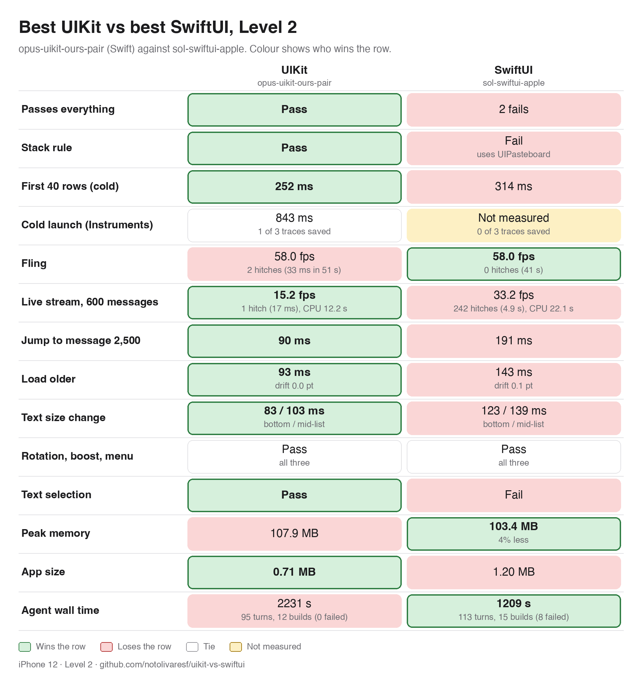

# Level 2: best Swift UIKit, best Objective-C UIKit and best SwiftUI

Fernando asked (20 Oct) for the best UIKit build against the best SwiftUI build of Level 2, UIKit split into Swift and Objective-C, and then: "The best should be the best of each metric regardless if we mix and match." So each column shows, row by row, the best value among that stack's two Level 2 builds (Opus and Sol), and each cell names the build it came from. A column is therefore not one build. Every number is from `docs/results-l2.md` (round 1, iPhone 12).

(Dark version: `images/results-l2-best-dark.png`; rendered with `python3 Harness/tools/results_table.py --l2-best`.)

How a cell is chosen: lowest time, hitches, memory or size; pass if either build passed. Fling and stream lead with hitches (late frames you can see), fps second: fps counts redraws, so a build that redraws only when a message lands shows fewer frames without stuttering. The winner of a row is the best of the three columns; ties both win.

## Head to head (source build in brackets)

| Row | UIKit, Swift | UIKit, Objective-C | SwiftUI | Winner |
|---|---|---|---|---|
| Passes everything | pass (Opus) | 1 fail, selection (Opus and Sol) | 2 fails (Opus and Sol) | Swift |
| Stack rule | pass (Opus and Sol) | pass (Opus and Sol) | fail, UIPasteboard (Opus and Sol) | Swift, Objective-C |
| First 40 rows, cold | 196 ms (Sol) | 158 ms (Opus) | 314 ms (Sol) | Objective-C |
| Cold launch (Instruments) | 776 ms, 2 of 3 traces (Sol) | 736 ms, 2 of 3 traces (Sol) | not measured: 0 of 3 traces saved | Objective-C |
| Fling | 0 hitches, 58.2 fps, 49 s (Sol) | 1 hitch (50 ms), 58.3 fps, 52 s (Sol) | 0 hitches, 58.0 fps, 41 s (Sol) | Swift, SwiftUI |
| Live stream, 600 messages | 1 hitch (17 ms), 15.2 fps, CPU 12.2 s (Opus) | 3 hitches (67 ms), 27.3 fps, CPU 11.9 s (Opus) | 242 hitches (4.9 s), 33.2 fps, CPU 22.1 s (Sol) | Swift |
| Jump to message 2500 | 77 ms (Sol) | 67 ms (Opus) | 154 ms (Opus) | Objective-C |
| Load older | 75 ms, drift 0.0 pt (Sol) | 34 ms, drift 0.1 pt (Opus) | 86 ms, drift 0.2 pt (Opus) | Objective-C |
| Text size change (bottom / mid-list) | 53 / 70 ms (Sol) | 55 / 75 ms (Sol) | 76 / 108 ms (Opus) | Swift |
| Rotation, boost burst, context menu | pass (both) | pass (both) | pass (both) | tie |
| Text selection | pass (Opus) | fail (Opus and Sol) | fail (Opus and Sol) | Swift |
| Peak memory | 44.5 MB (Sol) | 35.0 MB (Sol) | 103.4 MB (Sol) | Objective-C |
| App size | 0.64 MB (Sol) | 0.66 MB (Opus) | 1.20 MB (Sol) | Swift |
| Agent wall time, turns, builds (failed) | 1233 s, 90, 14 (7) (Sol) | 1297 s, 118, 24 (8) (Sol) | 1209 s, 113, 15 (8) (Sol) | SwiftUI |

Cold launch is not comparable to Level 1: only 2 of 3 traces saved for the measured builds, and for SwiftUI none saved before the 300 s cap.

## Win counts

Of 14 rows: Swift UIKit wins 7 (passes everything, stack rule shared, fling shared, stream, text size, text selection, app size), Objective-C UIKit wins 6 (stack rule shared, first content, cold launch, jump, load older, peak memory), SwiftUI wins 2 (fling shared, agent time); one row is a tie.

## Takeaways

- Mixing and matching narrows the field: UIKit in Swift and in Objective-C win 12 of the 14 rows between them (7 and 6, with the stack rule and fling counted for the stack that shares it), SwiftUI wins 2 (fling shared, agent time), one row is a tie.
- Correctness is still one-sided: only Swift UIKit (the Opus build) passes everything; Objective-C misses text selection in both builds; SwiftUI fails the stack rule (it uses UIKit's UIPasteboard for Copy) and selection in both.
- The stream is the biggest gap: 242 hitches and 22.1 s of CPU for SwiftUI against 1 to 3 hitches and about 12 s for both UIKit stacks. Its higher fps (33.2) is redraws, not smoothness.
- Fling is a draw at the top: Swift UIKit and SwiftUI both get 0 hitches (different Sol builds), and Objective-C's best has 1; fps is 58.0 to 58.3 everywhere.
- Objective-C UIKit is quickest and leanest: first content 158 ms, load older 34 ms, 35.0 MB against 44.5 MB (Swift) and 103.4 MB (SwiftUI). Swift UIKit wins text size (53 against 55 ms, close) and app size (0.64 against 0.66 MB, close).
- Agent cost is nearly level when the best build is taken (1209 to 1297 s, all Sol), with SwiftUI first by 24 s, but it took 8 failed builds against 7 for Swift and 8 for Objective-C, so there is no clear saving.
