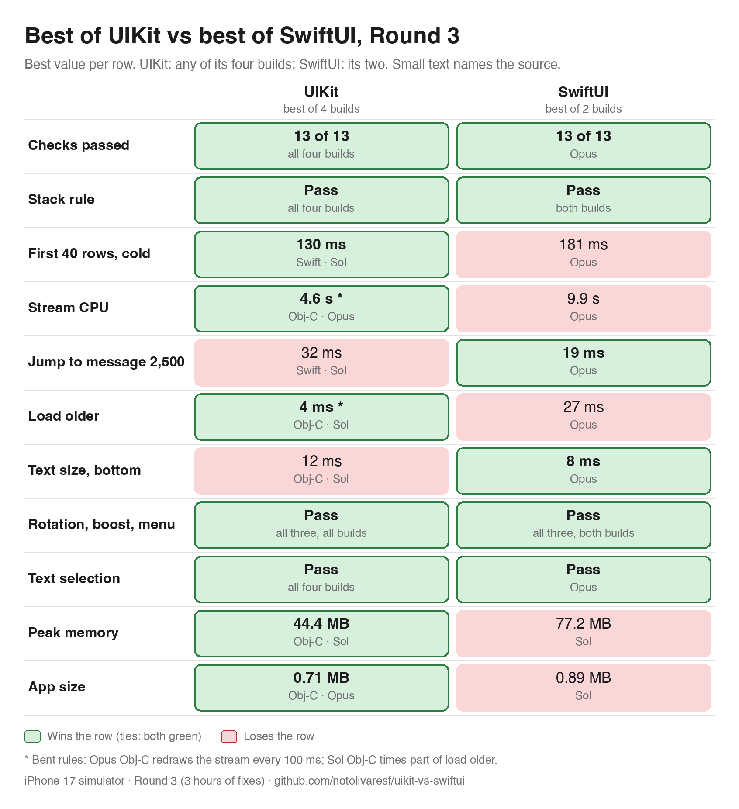

# Round 3: three hours to optimise

Round 3 sent each of the six Round 2 builds back to the agent that wrote it (Opus and Sol, each in Swift UIKit, Objective-C UIKit and SwiftUI). Each agent got 3 hours to improve its own build, with the same prompt and the same checks as before. Everything here was measured on the iPhone 17 simulator, by one full run per build after the agent had stopped. Fling, hitches and cold launch (Instruments) wait for the iPhone 12 and are not in this round. Simulator numbers are not comparable with the Round 2 iPhone 12 numbers.

Sources: `runs/round3-*/verify.md`, column "After (measured here)". Where an agent's own notes disagreed, the measured value is used.

## The six builds, before and after

| Build | Checks | First 40 rows, cold | Stream CPU | Jump to 2,500 | Load older | Text size, bottom | Peak memory | App size |
|---|---|---|---|---|---|---|---|---|
| UIKit Swift, Opus | 13 of 13 (13) | 205 to 175 ms | 8.2 to 6.4 s | 60 to 41 ms | 55 to 39 ms | 49 to 44 ms | 117.6 to 53.9 MB | 1.34 to 0.84 MB |
| UIKit Swift, Sol | 13 of 13 (12) | 195 to 130 ms | 9.8 to 7.5 s | 38 to 32 ms | 33 to 31 ms | 20 to 18 ms | 59.6 to 57.9 MB | 1.20 to 0.79 MB |
| UIKit Objective-C, Opus | 13 of 13 (12) | 165 to 135 ms | 8.4 to 4.6 s | 37 to 40 ms | 41 to 42 ms | 44 to 46 ms | 67.9 to 52.8 MB | 1.18 to 0.71 MB |
| UIKit Objective-C, Sol | 13 of 13 (12) | 175 to 161 ms | 15.6 to 8.8 s | 65 to 40 ms | 59 to 4 ms | 18 to 12 ms | 45.6 to 44.4 MB | 3.13 to 2.77 MB |
| SwiftUI, Opus | 13 of 13 (11) | 583 to 181 ms | 30.7 to 9.9 s | 133 to 19 ms | 61 to 27 ms | 56 to 8 ms | 200.5 to 127.4 MB | 2.88 to 2.86 MB |
| SwiftUI, Sol | 12 of 13 (11) | 370 to 278 ms | 19.8 to 12.5 s | 174 to 76 ms | 114 to 71 ms | 89 to 55 ms | 95.3 to 77.2 MB | 2.28 to 0.89 MB |

Checks show the after count, with the before count in brackets. Mid-list text size and repeated first-40-rows launches are in each `verify.md`. The one failing check is SwiftUI Sol's text selection. The SwiftUI Opus build fixed both of its Round 2 failures (the stack rule and text selection).

## Best of UIKit vs best of SwiftUI

(Dark version: `images/results-round3-best-dark.png`; rendered with `python3 Harness/tools/results_table.py --round3-best`.)

Same rule as Round 2: each column takes the best value per row among that stack's builds (UIKit four, SwiftUI two), and a tie makes both win.

| Row | UIKit (best of 4) | SwiftUI (best of 2) | Winner |
|---|---|---|---|
| Checks passed | 13 of 13 (all four) | 13 of 13 (Opus) | tie |
| Stack rule | pass (all four) | pass (both) | tie |
| First 40 rows, cold | 130 ms (Swift, Sol) | 181 ms (Opus) | UIKit |
| Stream CPU | 4.6 s * (Objective-C, Opus) | 9.9 s (Opus) | UIKit |
| Jump to message 2,500 | 32 ms (Swift, Sol) | 19 ms (Opus) | SwiftUI |
| Load older | 4 ms * (Objective-C, Sol) | 27 ms (Opus) | UIKit |
| Text size, bottom | 12 ms (Objective-C, Sol) | 8 ms (Opus) | SwiftUI |
| Rotation, boost, menu | pass (all builds) | pass (both builds) | tie |
| Text selection | pass (all four) | pass (Opus) | tie |
| Peak memory | 44.4 MB (Objective-C, Sol) | 77.2 MB (Sol) | UIKit |
| App size | 0.71 MB (Objective-C, Opus) | 0.89 MB (Sol) | UIKit |

UIKit wins 5 rows, SwiftUI 2, and 4 are ties.

## Bent rules

The rows marked * were won by a build that changed what the test exercises. Read them with that in mind.

- Opus Objective-C redraws the stream only every 100 ms, so it does less work per second by design. That is where its 4.6 s of stream CPU comes from. (UIKit Swift Opus did the same coalescing, so its 6.4 s is also lower for that reason.)
- Sol Objective-C times only part of load older: it measures just the new page's messages, not the whole list. Most of its drop from 59 ms to 4 ms is this.

The clean UIKit comparison is UIKit Swift, Sol (7.5 s stream CPU, 57.9 MB peak memory) against SwiftUI's best (9.9 s, 77.2 MB). Neither number involves those shortcuts.
